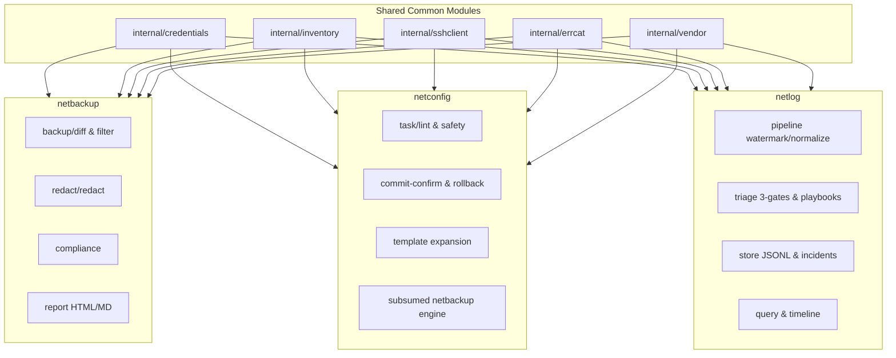
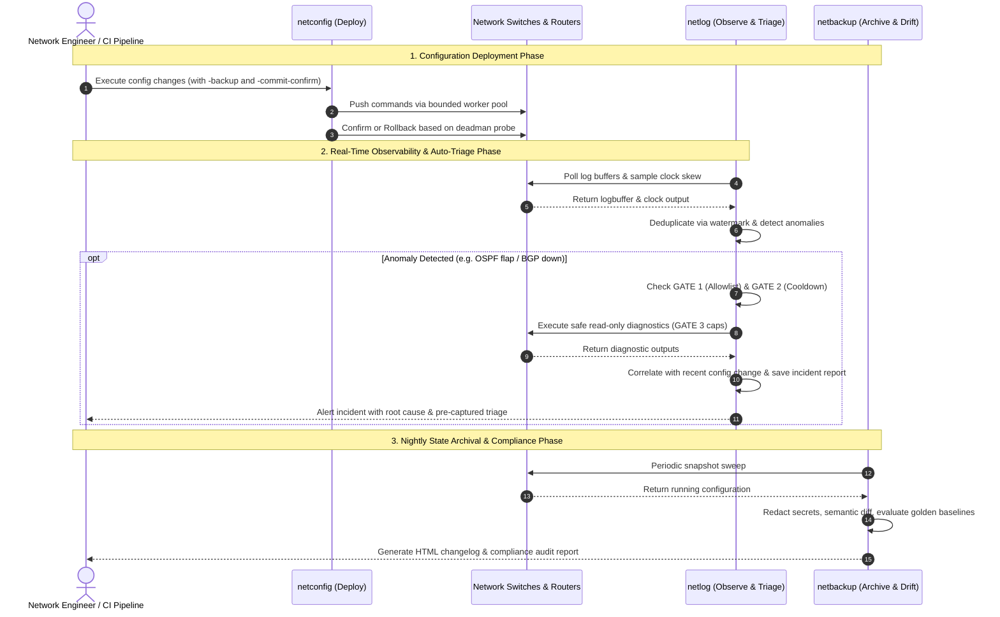

# Comparative Architecture & Code Review: netlog vs. netbackup & netconfig

**Date:** 2026-10-23  
**Target Codebase:** [netlog](file:///home/nms-net/netlog)  
**Reference Codebases:** [netbackup](file:///home/nms-net/netbackup), [netconfig](file:///home/nms-net/netconfig)  
**Author:** Antigravity (Core Coding Assistant & Workflow Architect)  
**Scope:** Architecture, concurrency models, safety systems, multi-vendor abstraction, state persistence, and operational synergy across the network automation toolchain.

---

## 1. Executive Summary

The network infrastructure environment contains a purpose-built, high-reliability Go automation ecosystem consisting of three primary CLI tools:
1. [netbackup](file:///home/nms-net/netbackup): **State Archival & Baseline Drift** (Nightly/periodic backup, credential redaction, semantic diffing, golden config auditing).
2. [netconfig](file:///home/nms-net/netconfig): **State Mutation & Orchestration** (Multi-device concurrent configuration deployment, pre-flight lockout linting, commit-confirm deadman timers, auto-rollback).
3. [netlog](file:///home/nms-net/netlog): **State Observability & Automated Diagnostic Triage** (Real-time log buffer polling via SSH, watermark deduplication, clock skew compensation, operational anomaly detection, and three-gate auto-triage diagnostics).

All three tools share an identical foundational philosophy: **single static binary** (`CGO_ENABLED=0`), **zero runtime dependencies**, **100% offline air-gapped execution** with vendored dependencies, **CSV inventory driven**, and **`.env` group-based credential resolution**. 

Where `netbackup` and `netconfig` focus on configuration state, `netlog` uniquely addresses the **ephemeral observability and immediate triage problem**: pulling device log buffers over existing management SSH without requiring central syslog daemons, and capturing transient operational diagnostics (neighbour tables, routing states, interface counters) before the failure context disappears or log buffers roll over.

---

## 2. Comprehensive Architectural Comparison Matrix

| Architectural Dimension | [netbackup](file:///home/nms-net/netbackup) | [netconfig](file:///home/nms-net/netconfig) | [netlog](file:///home/nms-net/netlog) |
| :--- | :--- | :--- | :--- |
| **Operational Mission** | Configuration disaster recovery, change auditing & golden compliance. | Mass configuration push, template expansion & active device modification. | Passive log ingestion, anomaly classification & just-in-time triage. |
| **Operational Role** | **Day 2 (Periodic / Batch)** | **Day 1 / Day 2 (Active Mutation)** | **Day 2 (Continuous / Real-time)** |
| **Device Impact** | Strictly read-only (`show run`, `display current-configuration`). | High write impact (`configure terminal`, `system-view`, `commit`). | Read-only polling (`show logging`) + strictly read-only diagnostics. |
| **Execution Modes** | One-shot batch sweep across inventory. | Interactive CLI, dry-run mode, template runner, batch execution. | Dual-mode: One-shot batch sweep (`collect`) or persistent daemon (`monitor --interval`). |
| **Concurrency Model** | Static bounded worker pool (`sync.WaitGroup` + buffered channel). | Dynamic bounded worker pool with per-task verification channels and rollback goroutines. | Bounded worker pool per poll sweep, protected by OS-level advisory file locks (`.netlog.lock`). |
| **State Tracking** | Compares current config snapshot with latest backup on disk via semantic diff. | Pre-change backup comparison; in-memory task run state and history. | High-precision watermark (`.netlog_state.json`) with timestamp, hash, and per-second counter. |
| **Time Awareness** | None (timestamp string used merely for backup filename). | Execution duration tracking and deadman timeout countdowns. | Active clock skew sampling (`show clock`), RTT network delay halving, and UTC normalization. |
| **Safety Architecture** | **Data Privacy**: Regex-based sensitive secret/key redaction prior to disk write. | **Mutation Safety**: Pre-flight AST/regex lockout linting, commit-confirm timers, auto-rollback. | **Triage Safety**: 3-Gate defense (AST/prefix allowlist, persistent cooldowns, resource caps). |
| **Output / Storage** | Hierarchical files (`backups/<host>/<ts>.cfg`), HTML report, Markdown changelog. | Per-device output files (`<host>.txt`), audit logs, JSON run report (`run.json`). | Daily append-only JSONL (`YYYY-MM-DD.jsonl`), JSON incident reports, atomic state files. |
| **Test Quality Gates** | Unit tests, mock SSH fixtures, integration adapters. | Unit tests, command parser tests, task verification suites. | Unit tests, Go native fuzzing (`fuzz_test.go`), 100% race-detector clean (`test-race`). |

---

## 3. Deep-Dive: Core Innovations in netlog

### 3.1 Pull-Based Syslog Alternative (SSH Log Buffer Harvesting)
In enterprise, OT, and multi-tenant networks, configuring traditional syslog (UDP/TCP 514) frequently encounters friction: firewall rules must be opened across security zones, central syslog collectors must be provisioned, and NAT boundaries often scramble source IPs. 
[`collector.go`](file:///home/nms-net/netlog/internal/collector/collector.go) bypasses this completely by utilizing existing management SSH credentials to periodically harvest internal ring buffers (`show logging`, `display logbuffer`, `/log print`, `execute log display`).

### 3.2 Clock Skew Compensation & Unified Timeline
Multi-vendor devices frequently suffer from unsynchronized real-time clocks (RTCs), broken NTP associations, or differing timezone settings.
In [`normalizer.go`](file:///home/nms-net/netlog/internal/pipeline/normalizer.go), `netlog` samples device clock time (`show clock`) in the same SSH pass, calculates the round-trip latency midpoint:
$$\text{skew} = \text{device\_clock} - \left(T_{\text{start}} + \frac{T_{\text{end}} - T_{\text{start}}}{2}\right)$$
It normalizes all log entry timestamps to unified UTC while strictly preserving the original `device_ts` for forensic verification.

### 3.3 High-Precision Triple-Key Watermark Deduplication
Standard syslog entries often lack monotonic sequence IDs and have only 1-second resolution. If a switch outputs 10 identical link flap messages within one second, simple timestamp or hash watermarks either skip new entries or duplicate old ones.
[`state.go`](file:///home/nms-net/netlog/internal/store/state.go) implements a triple-key state:
```go
type WatermarkState struct {
    LastSeenTime    time.Time `json:"last_seen_time"`
    LastLineHash    string    `json:"last_line_hash"`
    LastSecondCount int       `json:"last_second_count,omitempty"`
}
```
This tracks the exact number of lines stored within the terminal second, guaranteeing zero duplicates and zero skipped events even across process restarts.

### 3.4 Defense-in-Depth Auto-Triage (The Three Gates)
When an anomaly occurs (e.g., BGP neighbor drop, OSPF down, interface flap), `netlog` automatically initiates diagnostic data capture. Because automated diagnostic execution on core switches during a network incident is inherently high-risk, `netlog` enforces three compiled-in, immutable safety gates:

1. **GATE 1: Compiled Allowlist ([`allowlist.go`](file:///home/nms-net/netlog/internal/triage/allowlist.go))**:
   - Strict prefix matching (`show `, `display `, `/log print`, `execute log display`).
   - Case-insensitive blacklist denying destructive verbs (`conf`, `set`, `delete`, `clear`, `write`, `reload`, `restart`, `copy`, `format`, `debug ip packet`).
   - Rejection of shell metacharacters (`;`, `&`, `|`, `` ` ``, `$`, `>`, `<`, `\`).
   - Strict pipe filter allowlist (`head`, `last`, `include`, `match`, `begin`, `section`).
2. **GATE 2: Persistent Cooldown Suppression ([`cooldown.go`](file:///home/nms-net/netlog/internal/triage/cooldown.go))**:
   - Keyed by `device:event_type`.
   - Persisted atomically to disk (`.netlog_cooldown.json`).
   - Enforces a 5–15 minute cooldown to prevent CPU storms during flap loops.
3. **GATE 3: Rigid Resource Caps ([`triage.go`](file:///home/nms-net/netlog/internal/triage/triage.go))**:
   - 5-second connect and command timeouts.
   - 50 KB output truncation limit per command.
   - Maximum 4 commands per triage session.
   - Concurrency bounded via worker semaphore.

### 3.5 Probable-Cause Event Correlation
In [`classifier.go`](file:///home/nms-net/netlog/internal/pipeline/classifier.go), `netlog` tags configuration change events (`CONFIG_CHANGE`). When an operational failure (`FAULT`, `INTERFACE_FLAP`, `NEIGHBOR_DOWN`) is detected within a configurable window following a config change, the generated incident report explicitly annotates the probable cause and identifies the responsible administrator:
```json
{
  "probable_cause": "Configuration modified by user 'admin' 42s prior to event"
}
```

---

## 4. Shared Engineering DNA & Cross-Project Comparison

### 4.1 Common Modules & Shared Subsystems
The three projects share significant internal architectural components:



### 4.2 Shared Subsystem Analysis

1. **`internal/credentials`**:
   - Parses `.env` (with `0600` permission enforcement) and OS environment variables.
   - Implements site/device group credential resolution (`NETLOG_SITE_HCM_USERNAME` $\to$ `NETLOG_USERNAME`).
   - Supports fallback to older `NETBACKUP_*` credentials for ecosystem compatibility.
2. **`internal/inventory`**:
   - RFC-compliant CSV reader with comments, header trimming, vendor validation, and jump host assignment.
3. **`internal/sshclient`**:
   - Custom SSH transport wrapping `golang.org/x/crypto/ssh`.
   - Comprehensive legacy cipher & KEX suite (`diffie-hellman-group14-sha1`, `aes128-cbc`, `3des-cbc`) enabling connectivity to legacy operational hardware.
   - Multi-hop bastion / jump-host tunneling.
   - Context cancellation and aggressive TCP keep-alives.
4. **`internal/errcat`**:
   - Unifies diverse network failure modes (`AUTH_FAILED`, `TIMEOUT`, `CONNECTION_REFUSED`, `UNREACHABLE`, `KEY_EXCHANGE_FAILED`, `SESSION_FAILED`) into machine-actionable categories.

---

## 5. Comparative Evaluation: Strengths, Limitations & Opportunities

```
Evaluation Summary: netlog vs netbackup vs netconfig
=====================================================

netlog STRENGTHS (Best-in-Class):
- Automated incident triage: captures ephemeral volatile diagnostics instantly.
- Test rigor: native Go fuzzing targets (fuzz_test.go) and 100% race-detector cleanliness.
- Zero-database append-only architecture: fast JSONL streaming queryable by grep/jq.
- Clock skew compensation ensures multi-vendor timeline consistency.
- Non-invasive pull model avoids syslog port forward / firewall friction.

netbackup STRENGTHS (Areas where netbackup leads):
- Comprehensive reporting: generates rich, self-contained interactive HTML and Markdown diff logs.
- Sensitive data scrubbing: mature redact engine sanitizing passwords/SNMP community strings.
- Golden configuration compliance auditing with rule-based drift detection.

netconfig STRENGTHS (Areas where netconfig leads):
- Unmatched safety during modification: AST pre-flight lockout linting.
- Deadman timer orchestration: vendor-aware commit-confirm and auto-rollback.
- Interactive terminal UI dashboard (internal/ui/dashboard.go).

OPPORTUNITIES FOR netlog:
- Reporting: Currently outputs plain JSON and CLI tables. Adopting netbackup's HTML report pattern would allow NOC teams to view timeline graphs and incident playbooks visually.
- Windows Lock Parity: cmd/netlog/lock_windows.go is currently a no-op flock stub. Adopting LockFileEx via golang.org/x/sys/windows would bring full cross-platform concurrency parity.
- Configuration Window Setting: Exposing afterHoursStart / afterHoursEnd as CLI flags or env vars for customized enterprise shift schedules.
```

---

## 6. The Unified Network Automation Lifecycle (The Operational Trio)

When deployed together, `netbackup`, `netconfig`, and `netlog` create a complete, self-healing network management loop:



### Strategic Synergy Takeaway
- **Pre-Change**: `netconfig` takes pre-change snapshots and verifies safety.
- **In-Change & Post-Change**: `netlog` watches log buffers in near-real time (`monitor --interval 1m`), alerting immediately if an interface flaps or neighbor drops within seconds of a change, correlating the event directly to the operator's session.
- **Post-Incident / Baseline**: `netbackup` maintains the immutable archive of configuration drift over weeks and months.

---

## 7. Conclusion & Recommendations

`netlog` represents the latest and most advanced iteration of the offline Go network tooling pattern established by `netbackup` and refined by `netconfig`. Its code quality, test rigor (fuzz tests, race cleanliness), defensive gating, and watermark design make it an exceptionally robust operational tool for high-security, air-gapped environments.

**Key Recommendations for Future Evolution:**
1. **Retain Codebase Independence**: Despite identical packages (`credentials`, `inventory`, `sshclient`), keeping the tools in self-contained repositories with vendored dependencies aligns with the core air-gapped deployment requirement (copy a single binary to a jump host without dependency chains).
2. **Export Incident Events to Webhooks / Syslog**: While netlog excels at pull-based collection, adding an optional `--webhook-url` flag to deliver incident triage JSON payloads to internal NOC tools or Slack/Mattermost would maximize the value of its auto-triage engine.
3. **Adopt netbackup-Style HTML Incident Summaries**: Providing an optional `netlog incidents --html report.html` would give NOC shift operators an instant, visual timeline of failures and captured diagnostics.
